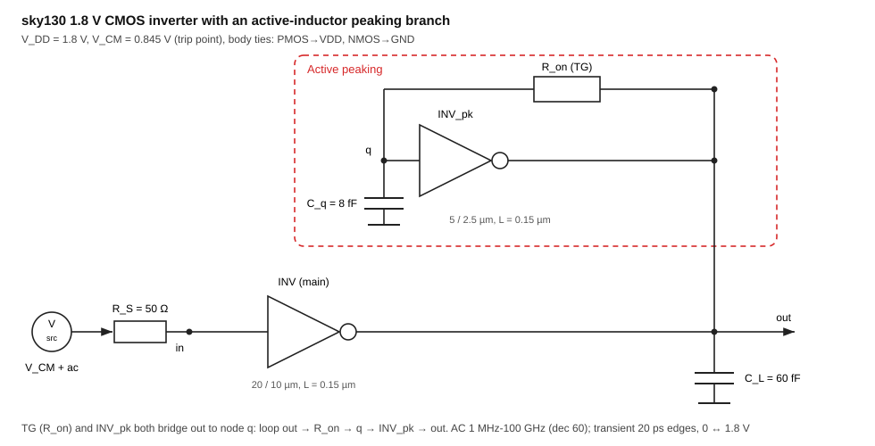
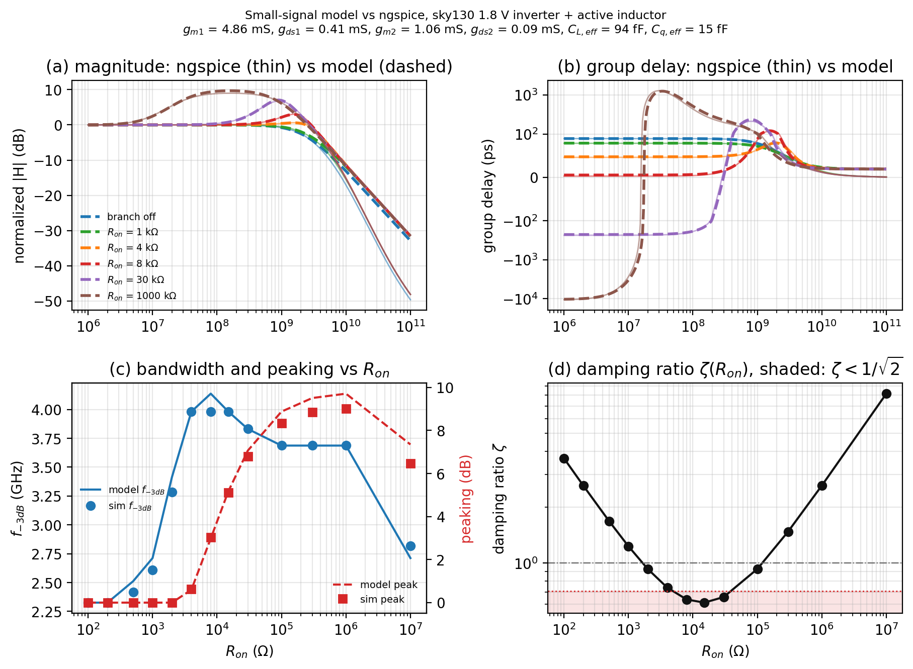
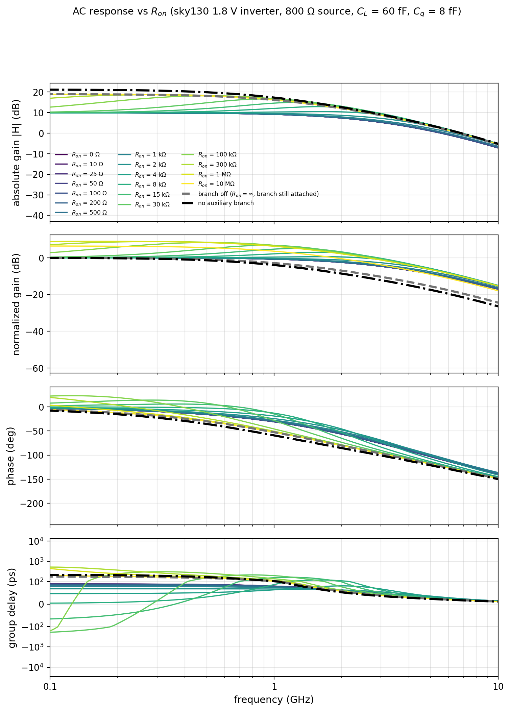
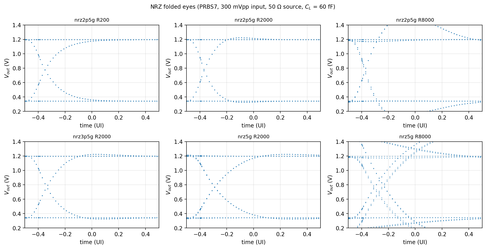
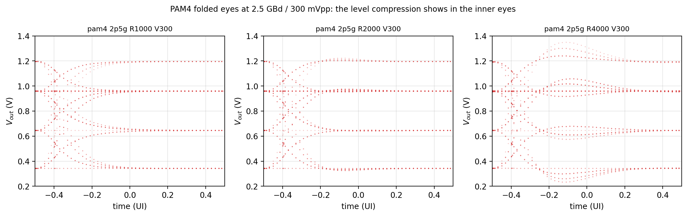
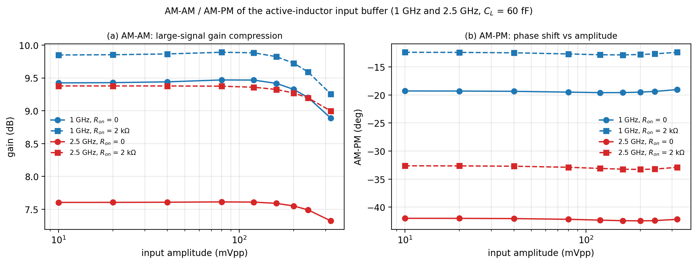
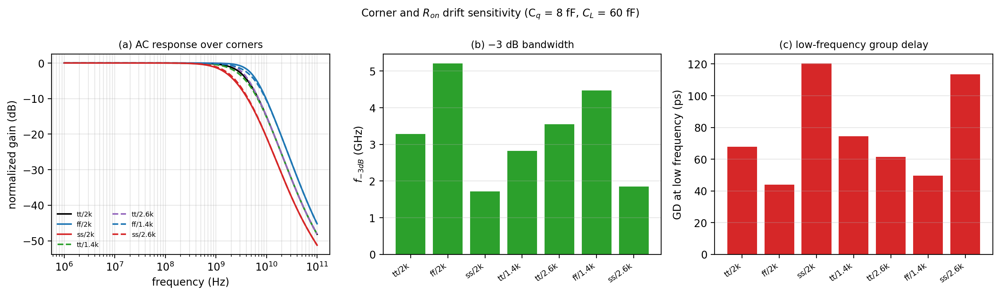
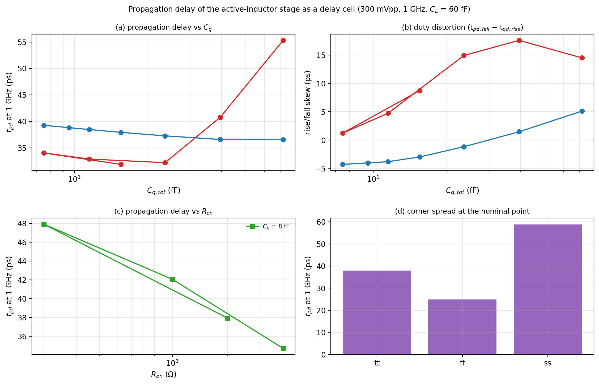
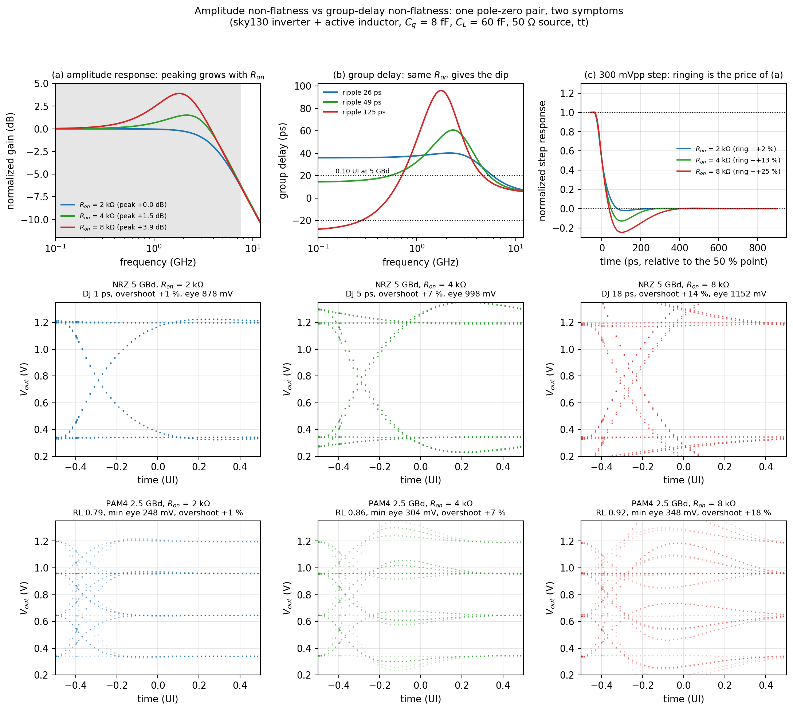
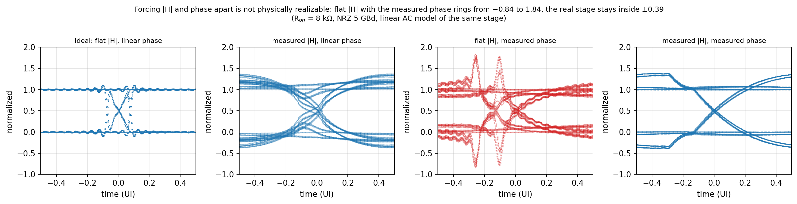

# Active Inductor Peaking in a CMOS Inverter - Analysis and Verification in sky130

> [!Note|style:callout|label:Infor]
> Initially published by YiDingg (assistanted by AI agent) at 23:40 on 2026-11-18 in Beijing.
> dingyi233@mails.ucas.ac.cn
>
> 本地预览版: 图片使用仓库内 assets/ 相对路径, 图床未开公共读时用这个版本; 正式版见同名文件 (图片走 OSS 图床)。

## Introduction

反相器大概是模拟电路里最便宜的增益级: 两只管子, 没有偏置电路, 占的地方也小。它的毛病是输出端挂上电容之后就成了单极点系统, 增益带宽积被 $g_m/C_L$ 锁死, 想要更高带宽基本只能加电流。

片上电感能绕开这个限制, 但面积大、Q 值低, 在低频段尤其不划算。有源电感走的是另一条路: 用几个小管子搭一条支路挂在输出端, 让它对输出呈现的阻抗随频率升高, 高频增益自然被抬起来。占的还是几个平方微米, 代价只是多一点静态电流和一点稳定性上的小心思。

这篇文章把这条支路完整跑一遍: 先说清楚它为什么"像电感", 再推小信号传函, 然后用 sky130 1.8 V 的晶体管级仿真给出 AC 响应、群延时、NRZ / PAM4 眼图、工艺角和延时单元的数据。最后单独用一节讨论一个经常被混为一谈的问题 —— 幅度不平坦和群延时不平坦, 究竟是怎么把波形弄坏的。

如果只想要结论: 这条支路在 $R_{on}$ 取 2 kΩ 附近是稳赚的 (没有峰化, 带宽最高, 眼图最干净); 到 8 kΩ 就变成拿眼高换抖动, 只能当峰化或延时单元用, 不能当数据通路。

## 1. 电路与直觉

### 1.1 拓扑

> 图 1. 本文的被测电路 (DUT)。主反相器 20 µm / 10 µm, 支路小反相器 INV_pk 5 µm / 2.5 µm, L 均为 0.15 µm; $C_L$ = 60 fF, $C_q$ = 8 fF; $V_{DD}$ = 1.8 V, 输入共模取翻转点 0.845 V。

主反相器把 in 反相到 out, 支路则从 out 出发: 经过一个传输门 (电阻记为 $R_{on}$) 到达节点 q, q 上挂 $C_q$, 再由小反相器 INV_pk 把信号送回 out。图上红色的虚线圈出这条支路。

这个接法初看不起眼, 但有两个细节值得留意。第一, INV_pk 的输入是 q, 它的输出接回 out, 而 q 又是从 out 取信号 —— 这是一个局部正反馈环, 只不过环路增益远小于 1, 不会再生 (regenerate), 它做的是另一件事: 在频率升高时把输出端的一部分容性负载"撤掉"。第二, $R_{on}$ 和 $C_q$ 构成一个极点, 这个极点落在环路里, 决定了在哪个频率上"撤负载"这件事开始生效。

### 1.2 所谓"电感"到底在哪

把支路从输出端看进去, 先算它的导纳。q 点的电压由 $R_{on}$ 与 $C_q$ 分压得到

$$v_q=\frac{v_o}{1+sR_{on}C_q}$$

INV_pk 从输出端抽走的电流是 $g_{m2}v_q$, 电阻支路里流过的是 $(v_o-v_q)/R_{on}$。两项相加:

$$Y_b(s)=\frac{1}{R_{on}}\left(1-\frac{1}{1+sR_{on}C_q}\right)+\frac{g_{m2}}{1+sR_{on}C_q}=\frac{g_{m2}+sC_q}{1+sR_{on}C_q}$$

这个式子已经把事情说清楚了, 分三段看:

低频时 $C_q$ 相当于开路, q 完全跟随 out, INV_pk 就是一只 $g_{m2}$ 的管子直接挂在输出上, 纯损耗。高频时 $C_q$ 把 q 短路到地, INV_pk 的输入被钉死, 不再抽电流, 支路只剩 $R_{on}$ 一条到地的电阻。中间这一段, 导纳从 $g_{m2}$ 单调降到 $1/R_{on}$, 转折点就是零点频率 $1/(R_{on}C_q)$。

导纳随频率下降, 阻抗就随频率上升, 这正是感抗的定义。把支路等效成串联 RL:

$$Z_b(s)=\frac{1}{Y_b(s)}=\frac{1+sR_{on}C_q}{g_{m2}+sC_q}$$

阻抗从 $1/g_{m2}$ 一路涨到 $R_{on}$。在本文的工作点 ($V_q\approx 0.82$ V) 实测 $g_{m2}\approx 1.06$ mS, 也就是 $1/g_{m2}\approx 0.95$ kΩ。这就给出一条很实用的判据: **只有 $R_{on}$ 大于约 1 kΩ, 支路才真的呈感性**。$R_{on}$ 太小的时候 (比如 200 Ω), 支路在整个频段里的导纳都高于 $g_{m2}$ 并且随频率上升, 等效出来是电容, 不但不峰化, 还会额外拖慢带宽。后面图 2(c) 里峰化在 1–2 kΩ 处起跳, 和这条判据对得上。

### 1.3 一般用在哪

| 用途 | 用它做什么 | 关心什么 |
|---|---|---|
| 输入缓冲 / 前级放大 | 补偿封装和走线的高频损耗, 把眼图重新打开 | 峰化量、群延时平坦度、过冲 |
| 延时单元 (DLL、相位插值) | 减小传播延时, 同时保留一定调节范围 | $t_{pd}$、单调性、上升/下降沿差 |
| CTLE 式均衡 | 用零点部分抵消信道的低通 | 零点频率、峰化量随码率的适配 |
| TIA / 环形振荡器 | 扩展带宽、压低级数 | 稳定性、工艺角散布 |

本文的数据主要服务前两种用途, 后两种只做趋势上的讨论。

## 2. 小信号模型

### 2.1 节点方程与传函

在输出节点和 q 节点列 KCL。先忽略体效应和 $C_{gd}$ 的密勒项, 这两部分稍后用等效电容补上:

$$
\begin{cases}
g_{m1}v_i+\dfrac{v_o-v_q}{R_{on}}+g_{m2}v_q+(g_{o1}+sC_L)v_o=0\\[6pt]
\dfrac{v_q-v_o}{R_{on}}+sC_q v_q=0
\end{cases}
$$

把 $v_q=v_o/(1+sR_{on}C_q)$ 代进第一式, 整理得到

$$
\boxed{
H(s)=\frac{v_o}{v_i}=
-\frac{g_{m1}\left(1+sR_{on}C_q\right)}
{s^2R_{on}C_qC_L+s\left(C_L+C_q+R_{on}C_qg_{o1}\right)+\left(g_{o1}+g_{m2}\right)}
}
$$

从这个式子可以直接读出三件事。

**直流增益**是 $A_0=g_{m1}/(g_{o1}+g_{m2})$。注意它跟 $R_{on}$ 没有关系 —— 直流下 $C_q$ 开路, 支路就是一个 $g_{m2}$ 的负载, 电阻多大都一样。代入工作点提取的 $g_{m1}=4.86$ mS、$g_{o1}=0.41$ mS、$g_{m2}=1.06$ mS, 算出来 10.4 dB, 仿真是 9.88 dB, 差的那一点来自 $R_S$ 分压和 $g_{ds2}$。这就是这条支路的隐性成本: 它把低频增益从 $g_{m1}/g_{o1}$ 拉到了 $g_{m1}/(g_{o1}+g_{m2})$, 在本文的参数下几乎腰斩。

**零点**在 $\omega_z=1/(R_{on}C_q)$。$R_{on}$ 越大、$C_q$ 越大, 零点越低, 越早进到信号带里。

**极点**由分母的二次式给出。这里不要急着把它拆成两个一阶项 —— 大 $R_{on}$ 时阻尼很低, 两个根是一对共轭复根, 硬拆会算错。代入等效参数 ($C_{q,eff}$ = 15 fF、$C_{L,eff}$ = 94 fF), $R_{on}$ = 8 kΩ 时 ζ ≈ 0.61, 固有频率约 1.82 GHz, 零点在 $1/(2\pi R_{on}C_{q,eff})$ 给出的 1.3 GHz。图 2 里量到的 1.82 GHz 峰、ζ = 0.61, 和这组数字完全对得上。

峰化的图像到这里就清楚了: 零点先把增益从直流值抬起来, 欠阻尼的复极点对再在固有频率上补一个峰, 两者叠出 1.8 GHz 附近那 3.9 dB。阻尼越低、零点越靠近固有频率, 峰就越高。

### 2.2 模型与仿真的对照

> 图 2. 小信号模型 (虚线) 与 ngspice (细实线) 的对照, 参数取自工作点提取: $g_{m1}$ = 4.86 mS, $g_{ds1}$ = 0.41 mS, $g_{m2}$ = 1.06 mS, $g_{ds2}$ = 0.09 mS, $C_{L,eff}$ = 94 fF, $C_{q,eff}$ = 15 fF。(a) 归一化幅度; (b) 群延时; (c) −3 dB 带宽与峰化随 $R_{on}$ 的变化; (d) 阻尼比 ζ。阴影区为 ζ < 1/√2, 即会出现幅度峰。

模型在 1 MHz 到 30 GHz 之间和晶体管级仿真几乎重合, 说明二阶加零点的结构已经抓住了主要行为。偏差集中在大 $R_{on}$ 的深零点附近, 那里等效电容随偏置漂移得比较厉害。

图 2(c) 有一处和直觉不一样: 峰化并不随 $R_{on}$ 单调上升, 而是先升后降, 在 300 kΩ 附近达到约 9 dB 的极大值。原因是零点与极点的相对位置同时受 $R_{on}$ 控制, $R_{on}$ 太大时支路电流太小, 反而托不动。阻尼比的最低点落在 10 kΩ 附近, 那里峰化最明显、过冲最大; 本文取 2 kΩ, 正好是阻尼比刚回到 1 以上的位置 —— 想峰化但不想振铃, 就应该待在这一侧。

## 3. 三个"延时"

"这个电路的延时是多少"这个问题, 答案取决于用哪个定义, 而三个口径的数值可以差将近一倍。

| 口径 | 定义 | 物理含义 | 本文数值 (800 Ω 源, 2 kΩ / 8 fF) |
|---|---|---|---|
| 相位延时 | $\tau_p=-\varphi(\omega)/\omega$ | 单一正弦成分被平移了多少 | +68 ps @ 1 MHz |
| 群延时 | $\tau_g=-d\varphi/d\omega$ | 窄带包络被延迟了多少 | +68 ps @ 低频; 带内可正可负 |
| 传播延时 | 输入/输出 50 % 交叉点之差 | 数字路径真正用到的延时 | **37.9 ps** @ 1 GHz |

三者之间的关系其实可以从定义直接写出来。相位延时是相位曲线的割线:

$$\tau_p(\omega)=-\frac{\varphi(\omega)}{\omega}$$

群延时是它的切线, 也就是对 $\omega\tau_p$ 求导:

$$\tau_g(\omega)=-\frac{d\varphi}{d\omega}=\tau_p(\omega)+\omega\frac{d\tau_p(\omega)}{d\omega}$$

相位严格线性时 ($\varphi=-\omega\tau$), 两者都等于 $\tau$, 完全重合; 相位一旦有曲率, 它们就分开, 曲率越大差得越多。拿最熟悉的单极点系统举例 ($\tau=1/\omega_0$):

$$\tau_p=\frac{\arctan(\omega\tau)}{\omega},\qquad \tau_g=\frac{\tau}{1+(\omega\tau)^2}$$

低频时两者都趋于 $\tau$; 频率上去以后, 群延时先塌下来, 相位延时则缓慢趋近 $\pi/(2\omega)$。本文的 68 ps 是 1 MHz 处取的 ($\omega\tau\approx 4\times10^{-4}$), 两种口径自然一样。

传播延时是另一回事, 它定义在时域:

$$t_{pd}=\left\{t: v_{step}(t)=0.5\right\}$$

它不由某个频点的相位斜率决定, 而由整个冲激响应决定。两者之间有一条严格的桥 —— 冲激响应的重心等于直流群延时:

$$\bar{t}=\frac{\int t\,h(t)\,dt}{\int h(t)\,dt}=\tau_g(0)$$

响应前后对称时, 重心正好落在 50 % 点上, 于是 $t_{pd}=\tau_g(0)$; 不对称时两者不等。一阶低通是对称的, 所以才有熟悉的 $t_{pd}=\tau\ln 2=0.693\tau$。本文的电路带零点、有峰化: 边沿上升段被拉陡, 中后段又留下振铃, 冲激响应的重心被这些晚到的能量拖在 68 ps, 而 50 % 交叉点只看前沿, 停在 37.9 ps。即使按一阶折算, $0.693\times68$ ps 也有 47 ps, 仍然偏大。

所以拿群延时去估延时单元的延时会系统性偏高, 连趋势都可能判反: 下一节会看到, 群延时随参数可以一路掉到负值, 而 $t_{pd}$ 始终为正。

### 3.1 群延时为什么会变成负的

> 图 3. 扫 $R_{on}$ 的完整 AC 响应 (800 Ω 源)。四张图自上而下: 绝对幅度、归一化幅度、相位、群延时。$R_{on}$ 从 0 Ω 一路扫到 10 MΩ; 两条对照曲线分别是灰色虚线的支路断开 ($R_{on}=1$ TΩ, 开关断开但支路仍挂在输出上) 和黑色点划线的无辅助支路 (整条支路拿掉)。

图里最容易被忽略的是这两条对照曲线之间的差。开关断开时 $R_{on}$ 里没有电流, 环路本该彻底断掉, 可辅助反相器的栅漏电容 $C_{gd}$ 还挂在输出上, 它把输出信号按约 0.15 的分压送到栅极, 再经 $g_{m2}$ 变成反馈电流。所以低频增益只回到 19.0 dB, 比真正的开环 21.2 dB 还差 2.2 dB, 带宽也停在 1.05 GHz, 而无辅助支路是 21.2 dB / 0.83 GHz。这条前馈随频率变强, 两条曲线的差距从 0.1 GHz 处的 2.2 dB 一路收到 20 GHz 处的 0.2 dB, 于是"断开"的带宽反而比"没有支路"更高。把 $C_q$ 加大可以把这条前馈多分掉一点 (0 → 64 fF 时增益从 18.4 回到 19.6 dB), 但单靠 $C_q$ 回不到开环。

第四张图里, $R_{on}$ 越大低频群延时越负, 到后面能到 −10⁴ ps 量级 (纵轴是对数)。负群延时不是超光速, 它是窄带效应: 零点给相位加了一个正斜率, 使 $d\varphi/d\omega>0$; 对一个窄带调制的信号, 包络峰确实可以比输入更早出现 —— 峰化把低频成分延迟得久、高频成分延迟得短, 叠出来的峰自然前移。但对只看过零点的时钟信号, 这个负值没有意义, 过零点永远往后走, 所以 $t_{pd}>0$。

### 3.2 群延时用在哪、在哪失效

"这个频率附近的包络整体后移了多少, 形状不变"这句话, 是群延时的前提假设, 不是它的结论。它来自把相位在 $\omega_0$ 附近做一阶展开:

$$H(j\omega)\approx|H(\omega_0)|e^{j\varphi_0}\cdot e^{-j\tau_g(\omega-\omega_0)}$$

右边第二项是纯线性相位, 在时域里就是一个纯粹的平移。这个近似成立的条件是调制带宽远小于相位曲率发生变化的尺度。窄带信号 (比如被低频包络调制的载波) 用起来很顺; NRZ / PAM4 这种基带信号谱宽和信号本身同量级, 一阶展开立刻失效。这时候再问"延时是多少"就没意义了, 应该直接看完整的 $\varphi(f)$, 或者干脆看眼图。

## 4. 数据通路: 眼图、压缩与角点

眼图和 AM-AM/AM-PM 的口径: 50 Ω 源阻抗, 300 mVpp 输入 (0.695 ↔ 0.995 V), PRBS7, $C_L$ = 60 fF, tt 角。4.3 节的角点扫描沿用第 2、3 节的 800 Ω 源, 方便和 AC 结果逐点对照, 两种源阻抗的差别放在 4.3 末尾单列。

### 4.1 NRZ 与 PAM4 眼图

> 图 4. NRZ 折叠眼图, 2.5 / 3.5 / 5 GBd, $R_{on}$ 分别取 200 Ω、1 kΩ、2 kΩ、4 kΩ、8 kΩ。$R_{on}$ = 8 kΩ 那一列可以看到明显的振铃, 眼图上下沿被撑开。

> 图 5. PAM4 折叠眼图, 2.5 GBd, $R_{on}$ = 1 / 2 / 4 kΩ。四个电平约 0.34 / 0.65 / 0.96 / 1.20 V, 内眼被限幅压窄。

| 用例 | $R_{on}$ | 摆幅 | 定时抖动 DJ | 过冲 | 电平比 RL (min/max) | 最小眼 |
|---|---|---|---|---|---|---|
| NRZ 5 GBd | 2 kΩ | 878 mV | 1.1 ps | +1 % | — | — |
| NRZ 5 GBd | 4 kΩ | 998 mV | 5.1 ps | +7 % | — | — |
| NRZ 5 GBd | 8 kΩ | 1 152 mV | 18.2 ps | +14 % | — | — |
| PAM4 2.5 GBd | 2 kΩ | 873 mV | — | +1 % | 0.79 | 248 mV |
| PAM4 2.5 GBd | 4 kΩ | 993 mV | — | +7 % | 0.86 | 304 mV |
| PAM4 2.5 GBd | 8 kΩ | 1 079 mV | — | +18 % | 0.92 | 348 mV |
| NRZ 5 GBd | 支路断开 ($R_{on}=\infty$) | 1 317 mV | 30.0 ps | +0.6 % | — | — |
| NRZ 5 GBd | 无辅助支路 | 1 624 mV | 22.6 ps | +6.2 % | — | — |
| PAM4 2.5 GBd | 支路断开 ($R_{on}=\infty$) | 1 120 mV | — | +5.3 % | 0.67 | 307 mV |
| PAM4 2.5 GBd | 无辅助支路 | 1 612 mV | — | +3.7 % | 0.88 | 513 mV |

表里最容易被误读的是 8 kΩ 那一行: $R_{on}$ = 8 kΩ 的眼高 1 152 mV 是三档里最大的, 但这其实是假象。它的输出电平被振铃撑到 0.27 / 1.28 V, 已经超出静态轨, 6σ 眼高只剩 663 mV, ISI 裕度从 41.9 dB 掉到 18.8 dB。只盯"眼高"这一项, 在这里一定会踩坑。

再解释一下 RL (level ratio, 电平比)。这是 PAM4 专用的指标, 定义为采样时刻四个电平相邻间隔的最小值比最大值。理想的 PAM4 三个间隔相等, RL = 1; 内眼被压窄时 RL 就掉下来。以太网规范 (IEEE 802.3 的 PAM4 条款) 的定义略有不同, 分母换成三个间隔之和, 记作 RLM:

$$\mathrm{RLM}=\frac{3\min(\Delta_i)}{\Delta_1+\Delta_2+\Delta_3}$$

本文这组数据换成 RLM 口径大约是 0.84 / 0.93 / 0.96。RL 每掉 10 %, 最差那只眼的等效 SNR 就掉 1 dB, 而 PAM4 的误码是由最差眼单独决定的。

表里最后四行是两种"支路不在"的对照。开关断开时输出电平仍被自偏置的辅助反相器钳在 1.63 V, 摆幅没放开, 带宽却只剩 1.26 GHz, NRZ 的 DJ 因此涨到 30 ps; PAM4 的电平比更掉到 0.67, 比任何有限 $R_{on}$ 都差。把整条支路拿掉, 摆幅才回到 1 624 mV, PAM4 的电平比回到 0.88。关掉开关并不等于拿掉支路。

### 4.2 幅度特性 AM-AM / AM-PM

> 图 6. 正弦激励下的 (a) 大信号增益与 (b) 相位随输入幅度的变化, 1 GHz 与 2.5 GHz, $R_{on}$ = 0 与 2 kΩ。

1 GHz 的增益是 9.42 dB (无支路) 和 9.85 dB (2 kΩ), 320 mVpp 时压缩只有 0.53–0.59 dB, 300 mVpp 以内基本是线性的。AM-PM 全程小于 0.3° (1 GHz) 和 0.6° (2.5 GHz), 这个拓扑可以不做补偿。支路最直接的收益也在这里: 2.5 GHz 增益从 7.60 dB 抬到 9.38 dB, 多出 1.8 dB, 同时 AM-PM 从 −42.0° 收到 −33.0°。

增益压缩和 AM-PM 都这么温和, 说明 300 mVpp 下输出还没有真正撞轨; PAM4 的 RL 只有 0.79, 是因为内眼被"软限幅"压扁了, 不是硬削波。

### 4.3 工艺角与 $R_{on}$ 漂移

> 图 7. (a) 归一化 AC 响应 (tt/ff/ss); (b) −3 dB 带宽; (c) 低频群延时。$C_q$ = 8 fF, $R_{on}$ = 2 kΩ (另含 ±30 % 漂移), 800 Ω 源。

| 角点 | $R_{on}$ | 低频增益 | $f_{-3dB}$ | 低频 GD | 2.5 GHz 增益 |
|---|---|---|---|---|---|
| tt | 2.0 kΩ | 9.88 dB | 3.29 GHz | +68 ps | −1.87 dB |
| ff | 2.0 kΩ | 8.38 dB | 5.21 GHz | +44 ps | −0.47 dB |
| ss | 2.0 kΩ | 12.01 dB | 1.71 GHz | +120 ps | −5.44 dB |
| tt | 1.4 kΩ | 9.88 dB | 2.82 GHz | +74 ps | −2.47 dB |
| tt | 2.6 kΩ | 9.88 dB | 3.55 GHz | +61 ps | −1.27 dB |

主导误差的是工艺角, 不是电阻。ss 角的带宽只有 tt 的 52 %, 2.5 GHz 处的增益掉了 5.4 dB; 而 $R_{on}$ 漂 ±30 % 只带来 ±0.4 GHz 的带宽变化和 ±7 ps 的群延时。换句话说, 这条支路对电阻漂移不敏感, 对工艺角很敏感, 想开环拿它当"标称延时"或"标称带宽"用是不现实的, 必须放进校准环里。

表里还有一处口径问题值得记一下: 同样 tt / 2 kΩ, 50 Ω 源时 $f_{-3dB}$ = 4.90 GHz、GD₀ = 36 ps, 800 Ω 源时是 3.29 GHz / 68 ps。前级的输出阻抗必须和后级一起算, 否则时序和带宽都会算错将近一倍。

## 5. 当延时单元用

> 图 8. 作为延时单元的传播延时 (1 GHz 方波, 300 mVpp, 800 Ω 源, $C_L$ = 60 fF)。(a) $t_{pd}$ 随 $C_{q,tot}$ 的变化, 蓝、红两条曲线分别对应 $R_{on}$ = 2 kΩ 与 8 kΩ, 横轴是标称 $C_q$ (取 0、2、4、8、16、32、64 fF) 加上 7.5 fF 寄生, 纵轴取上升沿与下降沿的平均; (b) 上升/下降沿延时差 $t_{pd,fall}-t_{pd,rise}$ 随 $C_{q,tot}$ 的变化, 同样是 $R_{on}$ = 2 kΩ 与 8 kΩ 两条曲线, 零线以上表示下降沿更慢; (c) 固定 $C_q$ = 8 fF, $t_{pd}$ 随 $R_{on}$ 的变化 (200 Ω、1 kΩ、2 kΩ、4 kΩ); (d) 标称点 ($R_{on}$ = 2 kΩ, $C_q$ = 8 fF) 的工艺角柱状图, tt / ff / ss。

| 条件 | $t_{pd,rise}$ | $t_{pd,fall}$ | 均值 | 沿差 |
|---|---|---|---|---|
| $R_{on}$ = 200 Ω | 50.6 ps | 45.2 ps | 47.9 ps | −5.5 ps |
| $R_{on}$ = 2 kΩ | 39.4 ps | 36.4 ps | 37.9 ps | −3.0 ps |
| $R_{on}$ = 8 kΩ | 27.5 ps | 36.2 ps | 31.9 ps | +8.7 ps |
| 2 kΩ, ff 角 | 25.3 ps | 24.5 ps | 24.9 ps | −0.8 ps |
| 2 kΩ, ss 角 | 61.2 ps | 56.4 ps | 58.8 ps | −4.8 ps |

从这张表能读出四件事。

调延时最有效的旋钮是 $R_{on}$, 不是 $C_q$。$R_{on}$ 从 200 Ω 到 8 kΩ, $t_{pd}$ 从 47.9 ps 压到 31.9 ps, 大约 16 ps 的可调范围; 而 $R_{on}$ = 2 kΩ 时扫 $C_q$ 只动了 2.7 ps。这和"用群延时看时 $C_q$ 调节范围巨大"的印象正好相反 —— 群延时的剧烈变化主要发生在低频相位曲线上, 并不等于过零点在移动。

$R_{on}$ = 8 kΩ 时 $t_{pd}$ 对 $C_q$ 是非单调的, 先降到 32 ps 左右再回升到 55 ps。做可编程延时线时这一档不能直接用, 会出现"码字变大、延时反而变小"的错位。

沿差随峰化加剧: 2 kΩ 时 −3.0 ps, 8 kΩ 时 +8.7 ps, 最大到 +17.6 ps。对时钟路径这就是占空比失真, 对数据路径就是额外的确定性抖动。

工艺角散布是 2.4 倍 (24.9 / 37.9 / 58.8 ps), 远大于任何电学调谐能给的范围。这类单元在真实设计里总是配一条校准环路, 不会靠标称延时硬撑。

所以做延时单元时, 规格表里应该写 $t_{pd}$ (上升沿、下降沿分开给), 不要写群延时。群延时可以留作"信号失真"的辅助指标, 但 FOM 用 $t_{pd}$ 和沿差。

## 6. 幅度不平坦 vs 群延时不平坦

这是本文最想讲清楚的一节。两种失真都叫"频响不平坦", 都对眼图不利, 但作用机制和能用的补救手段完全不同。

### 6.1 两种失真各自留下什么痕迹

> 图 9. 同一电路的三档峰化, 从左到右 $R_{on}$ = 2 / 4 / 8 kΩ。第一行: 幅度响应与群延时; 第二行: 300 mVpp 阶跃响应; 第三行: NRZ 5 GBd 眼图; 第四行: PAM4 2.5 GBd 眼图。

幅度不平坦在时域留下的痕迹是过冲和振铃: 阶跃响应在 8 kΩ 时下冲 25 %, 眼图上下沿被撑开, 眼高虚高。它对应的事实是"某些频率成分被放大了"。

群延时不平坦留下的痕迹是边沿被抹开、不同码型的历史被混在一起: 各频率成分到达时间不同, 边沿的上升段是它们错位叠加的结果。它对应的事实是"某些频率成分来晚了"。

| 观察量 | 幅度不平坦 | 群延时不平坦 |
|---|---|---|
| 阶跃响应 | 过冲/振铃, 振铃频率 ≈ 峰化频率 | 边沿不对称, 前驱振荡 |
| 眼图 | 眼高变化, 上下沿"外套"变厚 | 过渡区变宽, 斜边变厚 |
| 抖动分布 | 单峰, 随过冲展宽 | 多峰, 峰数 ≈ 码型历史类别 |
| 限幅能否改善 | 能 (削掉过冲) | 不能 (限幅不改时间) |
| 电路手段 | 调 $R_{on}$ 与 $C_q$ 控制峰化量 | 加均衡或降码率 |

最后两行最实用。如果问题出在幅度上, 加一级限幅或自动增益就能收; 如果出在群延时上, 只能在频域做均衡。

### 6.2 在本电路里, 两者拆不开

对任何无源 (或最小相位) 网络, 幅度与相位互为 Hilbert 变换的一对:

$$\varphi(\omega)=-\mathcal{H}\left\{\ln|H(\omega)|\right\}+\text{线性项}$$

本文的峰化来自同一对零极点: 零点把 1.8 GHz 附近的 $|H|$ 抬起 (+3.9 dB @ 8 kΩ), 同一对零极点把该频段的 $\tau_g$ 顶到 +96 ps, 又把更低频段的 $\tau_g$ 压到 −29 ps。$|H|$ 的峰和 $\tau_g$ 的谷总是成对出现, 这是它们的相位关系决定的。

为了把这件事说死, 我们做了一组"强行拆开"的数值实验: 用同一电路的 AC 结果做线性滤波, 分别只保留幅度、只保留相位。

> 图 10. 强制分离实验 ($R_{on}$ = 8 kΩ, NRZ 5 GBd, 线性 AC 模型)。四列依次为: 理想 (幅度平、相位线性)、只保留实测幅度、只保留实测相位、真实电路 (两者都保留)。

| 变体 | 归一化波形范围 |
|---|---|
| 理想: 幅度平坦、相位线性 | −0.10 … +1.10 |
| 只保留实测幅度, 相位线性化 | −0.37 … +1.37 |
| 只保留实测相位, 幅度取平 | **−0.84 … +1.84** |
| 实测 (两者都保留) | −0.39 … +1.39 |

第三行 (只留相位、幅度取平) 的振铃比真实电路还大一倍, 因为它相当于对一条低通做逆滤波, 高频增益被无代价地放大了。它不对应任何可实现的网络, 所以"把幅度调平、只留相位问题"这个思路在物理上不成立。

实际含义是: 把峰化当成一个整体参数 (一整对零极点) 来调, 不要试图分别调幅度和相位。这也是为什么这条支路的设计变量只有两个 —— $R_{on}$ 和 $C_q$。

### 6.3 设计判据

| 目标 | 幅度不平坦 | 群延时不平坦 | 依据 |
|---|---|---|---|
| NRZ ≤ 5 GBd | 峰化 ≤ 1.5 dB | 带内 GD 起伏 ≤ 0.15 UI (30 ps) | 4 kΩ 时 DJ 5 ps, 仍可接受; 8 kΩ 时 DJ 18 ps |
| PAM4 ≤ 5 GBd | 峰化 ≤ 1 dB | 带内 GD 起伏 ≤ 0.10 UI (20 ps) | 内眼对跳变错位最敏感, 留一半余量 |
| 延时单元 | 不在乎峰化 | 必须看 GD 与沿差 | 见第 5 节 |

具体到数字: 带内 GD 起伏 (0–5 GHz) 是 15 / 46 / 125 ps (2 / 4 / 8 kΩ), 折算到 5 GBd 分别是 0.08 / 0.23 / 0.63 UI。8 kΩ 那一档已经远超 PAM4 的判据, 只能当纯延时或峰化单元用。

## 7. 小结

1. 有源电感支路的本质是一个随频率上升的阻抗: 低频是 $1/g_{m2}$, 高频是 $R_{on}$, 转折点在 $1/(R_{on}C_q)$。它把输出端的一部分容性负载撤掉, 换来带宽和峰化。
2. 代价写在分子分母里: 直流增益从 $g_{m1}/g_{o1}$ 掉到 $g_{m1}/(g_{o1}+g_{m2})$, 同时零点带来过冲和群延时起伏。
3. 三个"延时"要分开看。本文同一电路 68 ps 和 37.9 ps 的差别, 就是选错口径的代价。
4. 作为输入缓冲, $R_{on}$ = 2 kΩ 是甜点: 没有峰化, 带宽最高, 眼图最干净。作为峰化或延时单元, 4–8 kΩ 才有意义, 但要接受过冲和抖动。
5. 幅度不平坦和群延时不平坦拆不开, 能调的只有"峰化总量"这一个旋钮。

## Reference

- [1] S. S. Mohan, M. del Mar Hershenson, S. P. Boyd, and T. H. Lee, "Bandwidth extension in CMOS with optimized on-chip inductors," *IEEE J. Solid-State Circuits*, vol. 35, no. 3, pp. 346–355, Mar. 2000.
- [2] B. Razavi, "The Cross-Coupled Pair — Part I [A Circuit for All Seasons]," *IEEE Solid-State Circuits Magazine*, vol. 6, no. 3, pp. 7–10, Summer 2014. [链接](https://ieeexplore.ieee.org/document/6882880)
- [3] IEEE Std 802.3cd-2018, *IEEE Standard for Ethernet — Amendment 3: Media Access Control Parameters for 50 Gb/s, 100 Gb/s, and 200 Gb/s Operation*, 2018 (PAM4 电平分离失配比 RLM 的定义).
- [4] SkyWater SKY130 PDK 文档: https://skywater-pdk.readthedocs.io
