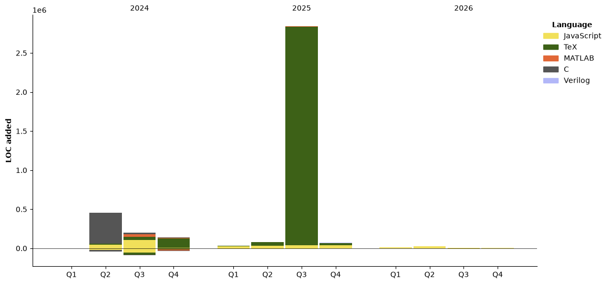

# About Me

<h2 style="text-align:center;"> Hello!👋(●'◡'●) I'm Yi Ding.</h2>

<div style="text-align:center;">
  • <a href="https://www.zhihu.com/people/YiDingg/posts">My ZhiHu</a><br>
  • <a href="https://github.com/YiDingg">My GitHub</a><br>

<!--   • <a href="https://yidingg.github.io/YiDingg">My Personal Website</a><br> -->

</div>

About Me:
- 🔭 I'm currently studying EE (Electronic Engineering) at [UCAS](https://www.ucas.ac.cn/)
- 📫 How to reach me: dingyi233@mails.ucas.ac.cn
- ⚡ Fun fact: I used to be a semi-professional soccer player as a national level two athlete.
- 🌱 I am currently learning about tranceivers/SerDes.

My Technology Stack: 
- LaTex
- MATLAB
- C Programming
- MCU (Micro-Controller Unit)
- PCB Layout
- Analog Circuit Design
- LTspice (ANALOG DEVICES)
- Cadence Virtuoso
- Analog IC Design (OPA, OTA, BGR, LDO, etc.)
- Mixed-Signal IC Design (DAC, VCO, PLL, CDR, etc.)
- Verilog, Verilog-A/AMS


[](https://github.com/anuraghazra/github-readme-stats)


<!--START_SECTION:waka-->


**I'm a Night 🦉** 

```text
🌞 Morning                131 commits         ██░░░░░░░░░░░░░░░░░░░░░░░   06.17 % 
🌆 Daytime                658 commits         ████████░░░░░░░░░░░░░░░░░   30.98 % 
🌃 Evening                667 commits         ████████░░░░░░░░░░░░░░░░░   31.40 % 
🌙 Night                  668 commits         ████████░░░░░░░░░░░░░░░░░   31.45 % 
```
📅 **I'm Most Productive on Friday** 

```text
Monday                   303 commits         ████░░░░░░░░░░░░░░░░░░░░░   14.27 % 
Tuesday                  263 commits         ███░░░░░░░░░░░░░░░░░░░░░░   12.38 % 
Wednesday                271 commits         ███░░░░░░░░░░░░░░░░░░░░░░   12.76 % 
Thursday                 343 commits         ████░░░░░░░░░░░░░░░░░░░░░   16.15 % 
Friday                   344 commits         ████░░░░░░░░░░░░░░░░░░░░░   16.20 % 
Saturday                 256 commits         ███░░░░░░░░░░░░░░░░░░░░░░   12.05 % 
Sunday                   344 commits         ████░░░░░░░░░░░░░░░░░░░░░   16.20 % 
```


📊 **This Week I Spent My Time On** 

```text
💬 Programming Languages: 
Markdown                 10 hrs 14 mins      █████████████████████████   99.88 % 
JSON                     0 secs              ░░░░░░░░░░░░░░░░░░░░░░░░░   00.11 % 
TeX                      0 secs              ░░░░░░░░░░░░░░░░░░░░░░░░░   00.01 % 

🐱‍💻 Projects: 
GH.YiDingg               10 hrs 15 mins      █████████████████████████   100.00 % 
```

🤖 **AI Coding This Week** 

```text
No AI Coding Activity Tracked This Week
```

**I Mostly Code in TeX** 

```text
TeX                      4 repos             ███████░░░░░░░░░░░░░░░░░░   28.57 % 
C                        4 repos             ███████░░░░░░░░░░░░░░░░░░   28.57 % 
MATLAB                   3 repos             █████░░░░░░░░░░░░░░░░░░░░   21.43 % 
JavaScript               2 repos             ████░░░░░░░░░░░░░░░░░░░░░   14.29 % 
Verilog                  1 repo              ██░░░░░░░░░░░░░░░░░░░░░░░   07.14 % 
```


**Timeline**




 Last Updated on 2026.11.05 10:49 UTC
<!--END_SECTION:waka-->


<!-- Coding activity over the last year -->
<div class='center'></div>

<!-- Languages over the last year -->
<div class='center'></div>
